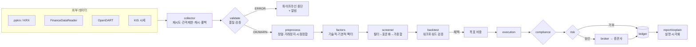
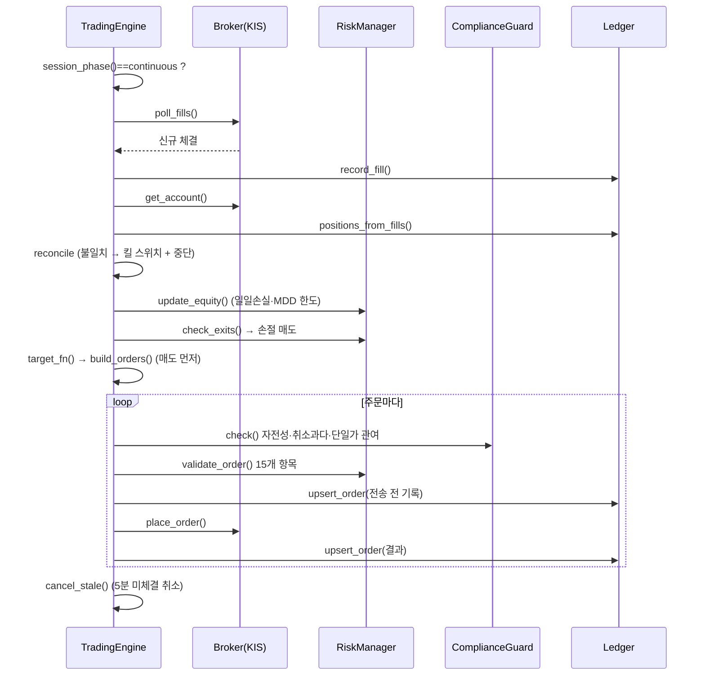

# 국내 주식 AI 분석·추천·자동매매 시스템 설계서

> 대상: 한국 주식시장 기반 자동매매 시스템을 만들려는 개발자·AI 엔지니어·금융 데이터 분석가
> 구현 코드: 이 저장소의 `ktrader/` 패키지(파이썬 3.10+). 모든 설계 항목에 대응하는 실제 코드 위치를 표기했다.
> 실행 확인: `python -m ktrader demo` (네트워크 없이 합성 데이터로 1~7단계 전체 실행), `python -m ktrader demo-global` (해외 포함), `pytest -q` (56개 테스트)
> 해외 시장(미국·일본·홍콩) 확장: [`GLOBAL.md`](GLOBAL.md)

---

## 목차

0. [설계 원칙과 범위](#0-설계-원칙과-범위)
1. [전체 시스템 구조도](#1-전체-시스템-구조도)
2. [1단계 · 데이터 자동 수집](#2-1단계--데이터-자동-수집)
3. [2단계 · 전처리와 데이터 품질 검증](#3-2단계--전처리와-데이터-품질-검증)
4. [3단계 · 종목 선별 분석 모델과 알고리즘 선정](#4-3단계--종목-선별-분석-모델과-알고리즘-선정)
5. [4단계 · 전략 백테스트 방법론](#5-4단계--전략-백테스트-방법론)
6. [5단계 · 자동매매 알고리즘 설계와 구현](#6-5단계--자동매매-알고리즘-설계와-구현)
7. [6단계 · 리스크 관리, 수익률 추적, 거래 기록](#7-6단계--리스크-관리-수익률-추적-거래-기록)
8. [7단계 · 사용자 설명 기능](#8-7단계--사용자-설명-기능)
9. [8단계 · 사용자 데이터 보호와 합법적 거래 준수](#9-8단계--사용자-데이터-보호와-합법적-거래-준수)
10. [모듈·함수 명세 총괄표](#10-모듈함수-명세-총괄표)
11. [운영 절차, 사용자 실수 방지, 장애 대응](#11-운영-절차-사용자-실수-방지-장애-대응)
12. [용어 풀이](#12-용어-풀이)

---

## 0. 설계 원칙과 범위

| 원칙 | 구체적 의미 | 구현 위치 |
|---|---|---|
| 미래 정보 차단 | t일 의사결정에는 t일 종가까지의 정보만 사용, 체결은 t+1일 시가 | `backtest/engine.py`, `data/preprocess.py::align_fundamentals_pit` |
| 단일 인터페이스 | 백테스트·로컬 모의체결·증권사 모의투자·실계좌가 같은 `Broker` 인터페이스를 공유 | `broker/base.py` |
| 모든 주문은 검증 후 전송 | 컴플라이언스 → 리스크 → 전송 순서 고정. 우회 경로 없음 | `execution/engine.py::submit` |
| 모든 결정은 기록·설명 | 신호·주문·거부 사유·체결을 원장에 남기고 한국어 문장으로 설명 | `ledger/store.py`, `report/explain.py` |
| 실패 시 멈춤(fail-safe) | 데이터 오류·잔고 불일치·손실 한도 초과 시 자동 중단, 사람의 확인 후 재개 | `data/validate.py::assert_quality`, `risk/manager.py::trigger_kill` |
| 비밀값 비노출 | 키·토큰·계좌번호는 환경변수로만 주입, 로그 자동 마스킹 | `security/secrets.py` |

**범위**: KRX 정규시장(KOSPI·KOSDAQ) 현물 주식, 일봉 기반 전략 + 장중 주문 집행.
**해외 확장**: 미국(NYSE·NASDAQ·AMEX)·일본(도쿄)·홍콩 정규장 현물 주식 → 별도 설계서 [`GLOBAL.md`](GLOBAL.md).
**범위 밖**: 대체거래소(NXT) 프리·애프터마켓, 미국 주간·프리·애프터마켓, 신용·미수·공매도, 파생상품, 초단타(HFT).

---

## 1. 전체 시스템 구조도

### 1.1 계층 구조

```
┌──────────────────────────────────────────────────────────────────────────────┐
│                           사용자 인터페이스 계층                                │
│   CLI (python -m ktrader)  │  리포트(Markdown/PNG)  │  알림(로그→메신저 연동)     │
└───────────────┬──────────────────────────────────────────────┬───────────────┘
                │                                              │
┌───────────────▼───────────────┐              ┌───────────────▼───────────────┐
│        분석·연구 계층            │              │          실거래 계층            │
│ ③ analysis/                    │  목표 비중    │ ⑤ execution/engine.py          │
│   indicators · factors         ├─────────────►│   주문 생성 → 검증 → 전송 → 대사   │
│   screener · model             │              │ ⑥ risk/manager.py (사전 점검)    │
│ ④ backtest/                    │              │ ⑧ security/compliance.py        │
│   engine · strategies          │              │ broker/ kis.py │ paper.py        │
│   metrics · validation         │              └───────┬────────────────┬───────┘
└───────────────▲───────────────┘                      │ REST/WebSocket  │ 기록
                │ 검증된 데이터                          ▼                 ▼
┌───────────────┴───────────────┐        ┌────────────────────┐ ┌──────────────────┐
│        데이터 계층               │        │ 한국투자증권 Open API │ │ ⑥ ledger/store.py │
│ ① data/collector.py            │        │ (모의/실전 서버)      │ │ SQLite: 주문·체결· │
│ ② data/validate.py             │        └────────────────────┘ │ 잔고·신호·감사로그  │
│   data/preprocess.py           │                               └──────────────────┘
└───────────────▲───────────────┘
                │
   pykrx · FinanceDataReader · KRX Open API · OpenDART · KIS 시세
```

### 1.2 데이터 흐름(Mermaid)



### 1.3 하루 운영 타임라인(KST)

| 시각 | 작업 | 모듈 |
|---|---|---|
| 07:30 | 전일 데이터 수집(일봉·밸류에이션·공시) → 품질 검증 | `collector`, `validate` |
| 08:00 | 팩터 계산 → 스크리닝 → 목표 비중 산출 → 설명 리포트 생성 | `factors`, `screener`, `explain` |
| 08:30~09:00 | 시가 단일가: **신규 주문 없음**(가격 왜곡 위험·시가 관여 오인 방지) | `krx.session_phase` |
| 09:05 | 계좌 동기화·원장 대사 → 손절 점검 → 리밸런싱 주문 | `execution.run_cycle` |
| 09:05~15:20 | 1분 주기 사이클: 체결 수집, 미체결 정리, 손절 감시 | `run_forever` |
| 15:20~15:30 | 종가 단일가: 신규 주문 없음 | `session_phase` |
| 15:40 | 일일 정산: 평가금액 기록, 성과·거래 리포트, 감사로그 무결성 확인 | `ledger`, `report` |

> 연초 개장일(10:00 개장), 대학수학능력시험일(개장 지연) 등 특수 일정은 `session_phase(holidays=...)`와 별도 일정표로 관리한다.

### 1.4 디렉터리 구조

```
ktrader/
├── config.py            # 비용·리스크·접속 설정(단일 출처)
├── krx.py               # 호가단위, 가격제한폭, 장 구분
├── data/
│   ├── collector.py     # 수집기(pykrx/FDR/OpenDART) + 재시도·캐시
│   ├── validate.py      # 품질 검증 → DataQualityReport
│   ├── preprocess.py    # 정제, 시점정합, 윈저라이징, z-score
│   └── sample.py        # 오프라인 합성 데이터
├── analysis/
│   ├── indicators.py    # SMA/EMA/RSI/MACD/볼린저/ATR/모멘텀/변동성
│   ├── factors.py       # 팩터 정의(한글 설명 포함) + 팩터 테이블
│   ├── screener.py      # 필터, 다중팩터 점수, IC
│   └── model.py         # ML 순위모델, 워크포워드, 모델 선정
├── backtest/
│   ├── engine.py        # 일 단위 이벤트 백테스터
│   ├── strategies.py    # 모멘텀/가치/RSI 역추세/멀티팩터/벤치마크
│   ├── metrics.py       # 성과 지표(한글 라벨)
│   └── validation.py    # 워크포워드 최적화, 파라미터 안정성
├── broker/              # base(인터페이스) · paper(가상체결) · kis(한국투자증권)
├── risk/manager.py      # 사전 점검, 사이징, 손절, 킬 스위치
├── execution/engine.py  # 실거래 사이클, 대사, 운영 루프
├── ledger/store.py      # SQLite 원장 + 해시체인 감사로그
├── report/              # explain(설명문) · charts(시각화)
├── security/            # secrets(비밀관리·마스킹·암호화) · compliance(준법)
└── cli.py               # demo / screen / backtest / trade
```

---

## 2. 1단계 · 데이터 자동 수집

### 2.1 데이터 소스

| 데이터 | 1순위 | 폴백 | 비고 |
|---|---|---|---|
| 종목 목록(기준일) | `pykrx.stock.get_market_ticker_list(date, market)` | `FinanceDataReader.StockListing("KOSPI")` | FDR 폴백은 '현재' 상장 목록만 제공 → 생존편향 주의 |
| 일봉 OHLCV(수정주가) | `pykrx.stock.get_market_ohlcv(start, end, ticker, adjusted=True)` | `fdr.DataReader(ticker, start, end)` → KIS `inquire-daily-itemchartprice` | 백테스트는 수정주가, 주문은 실시간 원주가 |
| PER·PBR·EPS·BPS·배당 | `pykrx.stock.get_market_fundamental(date, market)` | KRX Open API(openapi.krx.co.kr, 인증키) | 일자별 스냅샷 |
| 시가총액·상장주식수 | `pykrx.stock.get_market_cap(date, market)` | KRX Open API | |
| 재무제표 | OpenDART `fnlttSinglAcntAll.json` | — | 공식 API, 인증키 필요, 일 요청 한도 있음 |
| 공시 목록 | OpenDART `list.json` | — | 이벤트 필터(유상증자, 감자 등) |
| 실시간 시세·호가 | KIS WebSocket `H0STCNT0`(체결), `H0STASP0`(호가) | KIS REST `inquire-price` | 계좌 필요 |
| 종목 상태(관리·경고·정지) | KIS `inquire-price`의 종목상태코드 | KRX 시장경보 공시 | 매수 제한 목록에 반영 |
| 무위험금리(CD91 등) | 한국은행 ECOS API | — | 샤프지수 계산용 |

> pykrx·FinanceDataReader는 공개 웹페이지를 이용하는 비공식 라이브러리라서, 제공처 정책·화면 구조가 바뀌면 동작이 멈추거나 로그인 등 추가 절차가 요구될 수 있다. 운영 시스템은 **공식 API(KRX Open API, KIS, OpenDART)를 최종 폴백**으로 반드시 갖춘다.

### 2.2 수집기 설계

```
get_ohlcv(ticker, start, end)
   │
   ├─ 캐시 존재? ──예──► 캐시 반환
   │
   └─ RateLimiter.wait()          # 요청 간 최소 간격(기본 0.5초)
        └─ @retry(3회, 1s→2s→4s)   # 일시 오류 재시도
             ├─ pykrx 호출
             └─ 실패 → FinanceDataReader 폴백
        └─ 컬럼 표준화(open/high/low/close/volume/value) → 캐시 저장
```

```python
from ktrader.data.collector import MarketDataCollector, DartClient

col = MarketDataCollector(cache_dir="./var/data", min_interval_sec=0.5)
tickers = col.get_tickers("20261030", "KOSPI")                    # DataFrame[ticker,name,market]
panel = col.get_ohlcv_panel(tickers.ticker[:200].tolist(), "20250101", "20261030")
#  panel["close"] → DataFrame(날짜×종목)
fund = col.get_fundamentals("20261030", "KOSPI")                   # index=ticker, PER/PBR/...

dart = DartClient(api_key=os.environ["DART_API_KEY"])
fs = dart.financial_statements("005930", 2025, "FY")               # 연결 사업보고서
dart.key_metrics(fs)   # {'roe': ..., 'debt_ratio': ..., 'op_margin': ...}
```

### 2.3 함수 명세

| 함수 | 입력 | 출력 | 동작 |
|---|---|---|---|
| `MarketDataCollector.get_tickers` | `date: "YYYYMMDD"`, `market` | `DataFrame[ticker, name, market]` | 기준일 상장 종목(생존편향 방지) |
| `.get_ohlcv` | `ticker`, `start`, `end`, `adjusted` | `DataFrame[open..value]`, DatetimeIndex | 재시도·폴백·캐시 |
| `.get_ohlcv_panel` | 종목 리스트, 기간 | `{필드: DataFrame(날짜×종목)}` | 실패 종목은 로그 후 제외 |
| `.get_fundamentals` | `date`, `market` | `DataFrame(index=ticker)` | PER/PBR/EPS/BPS/DIV + 시총 |
| `DartClient.corp_code_map` | — | `{종목코드: DART고유번호}` | ZIP(XML) 1회 다운로드 후 캐시 |
| `DartClient.financial_statements` | `ticker, year, report, consolidated` | `DataFrame[account_id, account_nm, sj_div, amount]` | status ≠ "000" 이면 예외 |
| `KISBroker.get_daily_ohlcv` | `ticker, start, end` | `list[dict]` | 공식 API 폴백 |

### 2.4 주의사항
- **생존편향**: 오늘 상장된 종목으로 과거를 테스트하면 상장폐지 종목이 빠져 성과가 부풀려진다 → 과거 각 시점의 종목 목록을 날짜별로 저장한다.
- **수정주가와 원주가 혼용 금지**: 신호 계산(수정주가)과 주문 가격(원주가)을 분리한다.
- **요청 한도**: OpenDART 일일 한도, KIS 초당 요청 제한을 넘기면 키가 일시 차단될 수 있다 → `RateLimiter` 필수.
- **데이터 이용 약관**: KRX·데이터 제공처의 데이터는 재배포·상업적 이용이 제한될 수 있다. 서비스로 제공할 경우 정식 라이선스를 확인한다.

---

## 3. 2단계 · 전처리와 데이터 품질 검증

### 3.1 처리 순서

```
원시 데이터 ─► validate_ohlcv() ─► [ERROR 있음] ─► assert_quality() 예외 → 해당 종목 제외 + 알림
                    │
                    └─► [OK/WARN/INFO] ─► clean_ohlcv() ─► 시점정합(align_fundamentals_pit)
                                                         ─► 윈저라이징 · z-score (팩터 단계)
```

### 3.2 검증 항목(`data/validate.py`)

| 검사 | 조건 | 심각도 | 의미와 조치 |
|---|---|---|---|
| 필수컬럼 | open/high/low/close/volume 누락 | ERROR | 수집 단계 오류 → 재수집 |
| 중복날짜 | 같은 날짜 2회 이상 | ERROR | 병합 오류 → 마지막 값만 유지 후 재검증 |
| 미래날짜 | 오늘 이후 날짜 | ERROR | 타임존·파싱 오류 |
| 결측·비양수가격 | NaN 또는 ≤ 0 | ERROR | 거래정지일을 0으로 기록한 소스 확인 |
| OHLC불일치 | 고가 < max(시가,종가) 또는 저가 > min(시가,종가) | ERROR | 원천 데이터 오류 |
| 가격제한폭초과 | 일간 변동률 > ±30% | 수정주가면 ERROR | 액면분할·병합 미반영 또는 신규상장/정리매매 → 수정주가 재수집 |
| 거래량0 | 거래량 = 0 | WARN | 거래정지 → 백테스트에서 체결 불가 처리 |
| 가격고착 | 5일 이상 종가 변화·거래 없음 | WARN | 장기 거래정지, 상장폐지 진행 여부 확인 |
| 거래량급증 | 로그 거래량 z-score > 6 | INFO | 공시·이벤트 확인 권장 |
| 거래일누락/휴장일데이터 | 거래소 달력 대비 | WARN/ERROR | 달력 불일치 |

### 3.3 실행 예시와 결과 해석

```python
from ktrader.data.validate import validate_ohlcv, assert_quality
rep = validate_ohlcv(df, "005930", calendar=krx_calendar)
print(rep.summary())
assert_quality(rep)          # ERROR가 있으면 DataQualityError 발생
```

데모 출력(의도적으로 오류를 주입한 데이터):

```
[100000(오류주입)] 757행, 최고 심각도 ERROR
  - ERROR 중복날짜: 같은 날짜가 두 번 이상 존재 (1건) 예: 2023-01-09
  - ERROR OHLC불일치: 고가<시가/종가 또는 저가>시가/종가 (1건) 예: 2023-01-16
  - ERROR 가격제한폭초과: 일간 변동률 ±30% 초과(분할·병합 미보정 또는 신규상장일 의심) (1건) 예: 2023-01-30
  - WARN  거래량0: 거래량 0(거래정지·매매거래중단 가능) (1건) 예: 2023-02-13
```
해석: 2023-01-30의 -50% 변동은 2:1 액면분할이 수정주가에 반영되지 않은 전형적 사례다. 이 데이터로 모멘텀을 계산하면 해당 종목이 '폭락주'로 잘못 분류된다. 따라서 ERROR가 있는 종목은 분석에서 자동 제외된다.

### 3.4 시점정합(Point-in-Time)

재무제표는 결산일이 아니라 **공시일** 이후에만 알 수 있다. `align_fundamentals_pit()`는 실제 공시일(`disclosed_at`)이 있으면 그것을, 없으면 법정 제출기한(사업보고서 결산 후 90일, 분기·반기 45일)을 공개일로 보고 날짜×종목 패널을 만든다.

```python
rec = pd.DataFrame({"ticker": ["005930"], "period_end": ["2025-12-31"], "report": ["FY"], "roe": [0.10]})
roe_panel = align_fundamentals_pit(rec, calendar, "roe")
# 2026-03-31 이전에는 NaN, 이후부터 0.10 → 미래 정보 누수 차단 (tests::test_point_in_time_alignment_has_no_lookahead)
```

### 3.5 정제 규칙(`clean_ohlcv`)
- 중복 제거(마지막 값 유지) → 날짜 정렬 → 거래소 달력으로 재색인
- 상장 전 구간은 채우지 않는다(NaN 유지)
- 상장 후 누락일·거래량 0일은 `suspended=True`, 종가는 직전값, 시·고·저가는 종가로 맞춤
- 팩터 단계: 상·하위 1% 윈저라이징 → z-score 표준화

---

## 4. 3단계 · 종목 선별 분석 모델과 알고리즘 선정

### 4.1 팩터 정의(`analysis/factors.py::FACTOR_SPECS`)

| 팩터 | 계산식 | 방향 | 분류 | 의미 |
|---|---|---|---|---|
| `mom_12_1` | P(t-21)/P(t-252) − 1 | + | 기술적 | 중기 추세. 최근 1개월 제외로 단기 반전 회피 |
| `mom_3` | P(t)/P(t-63) − 1 | + | 기술적 | 3개월 추세 |
| `trend_200` | P / SMA200 − 1 | + | 기술적 | 장기 추세 위 여부 |
| `rsi_14` | Wilder RSI(14) | − | 기술적 | 단기 과열 감점 |
| `vol_60` | 60일 수익률 표준편차×√252 | − | 위험 | 저변동성 선호 |
| `earnings_yield` | 1/PER (적자는 결측) | + | 기본적 | 이익 대비 저평가 |
| `book_yield` | 1/PBR | + | 기본적 | 자산 대비 저평가 |
| `roe` | 순이익/자기자본 | + | 기본적 | 수익성 |
| `liquidity` | 20일 평균 거래대금 | 필터 | 유동성 | 체결 가능성 |

### 4.2 점수화 알고리즘(`analysis/screener.py`)

```
1) 필터: 투자유의·관리종목 / 거래정지 / 주가 < 1,000원 / 평균거래대금 < 10억원 / 팩터 결측 > 30%
   → 제외 사유를 종목별로 기록
2) 각 팩터 f:  z_f = zscore(winsorize(x_f, 1%, 99%)) × direction_f
3) 기여도:     contrib_f = w_f / Σ|w| × z_f   (결측은 0 = 평균 취급)
4) 종합점수:   composite = Σ contrib_f
5) 순위 → 상위 N 추천, contrib_* 열은 설명 생성에 그대로 사용
```

기본 가중치: 모멘텀 0.25, 이익수익률 0.20, 순자산수익률 0.15, ROE 0.15, 200일 추세 0.10, 변동성 0.10, RSI 0.05.

### 4.3 알고리즘(모델) 선정 절차(`analysis/model.py`)

| 단계 | 내용 |
|---|---|
| ① 예측 대상 정의 | 향후 21거래일 수익률의 **횡단면 순위**(종목 간 상대 순위) |
| ② 데이터셋 구성 | 월말마다 팩터 순위(−0.5~0.5) → 피처, 이후 수익률 순위 → 라벨 |
| ③ 후보 모델 | 동일가중(기준), 릿지 회귀, (확장) LightGBM/XGBoost 순위모델 |
| ④ 검증 | 확장형 워크포워드, 학습·검증 사이 **엠바고 1기간**(라벨 기간 겹침 차단) |
| ⑤ 평가 지표 | 표본외 IC 평균, **ICIR**(IC 평균/표준편차), 적중률(IC>0 비율) |
| ⑥ 채택 규칙 | 기준 모델 대비 ICIR이 명확히 높고(예: +0.2 이상), 기간별로 일관될 때만 복잡한 모델 채택 |

데모 결과(합성 데이터):
```
   model  mean_ic  icir  hit_ratio  n
    릿지회귀    0.112 0.917      0.714 14
동일가중(기준)    0.110 0.813      0.786 14
```
해석: 릿지의 ICIR이 약간 높지만 표본(14개월)이 적고 적중률은 오히려 낮다. **차이가 작으므로 단순한 동일가중을 유지**하고 표본이 쌓이면 재평가한다. 이것이 과최적화를 피하는 보수적 선정 기준이다.

> 실데이터에서 IC 0.02~0.05가 꾸준히 유지되면 실용적으로 의미 있는 팩터다. 합성 데이터의 0.11은 생성 과정에 신호를 넣었기 때문이며 실제 기대치가 아니다.

---

## 5. 4단계 · 전략 백테스트 방법론

### 5.1 단계별 절차

| 단계 | 할 일 | 산출물 | 코드 |
|---|---|---|---|
| 1. 가설 | "12-1개월 모멘텀 상위 종목이 이후 1개월 초과수익" 처럼 검증 가능한 문장 | 가설 문서 | — |
| 2. 유니버스 | 기준일별 상장 종목 + 유동성 필터(생존편향 제거) | 날짜별 종목 목록 | `collector.get_tickers` |
| 3. 신호 | t일 종가까지 데이터로 목표 비중 | `generate_weights()` | `strategies.py` |
| 4. 체결 가정 | t+1일 시가, 슬리피지, 거래량 5% 상한, 상·하한가·정지 미체결 | 체결 내역 | `engine.py` |
| 5. 비용 | 매수 수수료, 매도 수수료+거래세 | 순수익 곡선 | `config.CostModel` |
| 6. 성과 측정 | CAGR, 변동성, 샤프, 소르티노, MDD, 회전율, 승률, 손익비, 알파·베타 | 지표표 | `metrics.py` |
| 7. 강건성 | 워크포워드 최적화, 파라미터 고원 확인, 비용 2배 스트레스, 하위기간 분할 | 검증표 | `validation.py` |
| 8. 판정 | 아래 채택 기준 충족 시에만 모의투자 단계로 이동 | 채택/기각 | — |

**채택 기준(예시)**: 비용 반영 후 벤치마크 대비 초과 CAGR > 0, 샤프 ≥ 0.7, MDD ≤ 25%, 워크포워드 검증구간 샤프가 학습구간의 50% 이상, 비용 2배에서도 초과수익 유지, 거래 100회 이상.

### 5.2 전략별 설계

| 전략 | 신호 | 리밸런싱 | 핵심 위험 | 코드 |
|---|---|---|---|---|
| 모멘텀 | 12-1개월 수익률 상위 10 동일가중, 유니버스 지수 < 200일선이면 현금 | 월 | 추세 반전 급락(모멘텀 붕괴) | `MomentumStrategy` |
| 가치 | 1/PBR + 1/PER 순위합 상위 10, 적자 제외 | 월 | 가치 함정(구조적 쇠퇴 기업) | `ValueStrategy` |
| 트레이딩(역추세) | 200일선 위 + RSI(2) < 10 매수, 회복 시 청산 | 일 | 높은 회전율 → 비용 민감 | `RsiMeanReversion` |
| 멀티팩터 | screener 종합점수 상위 15 | 월 | 팩터 간 상충 | `MultiFactorStrategy` |
| 벤치마크 | 유니버스 동일가중 | 월 | — | `BuyAndHoldEqual` |

### 5.3 실행 코드

```python
from ktrader.backtest.engine import Backtester, BacktestConfig
from ktrader.backtest.strategies import MomentumStrategy
from ktrader.backtest.metrics import compute_metrics, format_metrics
from ktrader.backtest.validation import walk_forward_optimize, parameter_stability

cfg = BacktestConfig(initial_cash=100_000_000, rebalance="M", trailing_stop_pct=0.15)
res = Backtester(cfg).run(panel, MomentumStrategy(top_n=10), fundamentals=None)
print(format_metrics(compute_metrics(res, benchmark=kospi_close, risk_free=0.03)))

# 과최적화 점검
wins = walk_forward_optimize(panel, lambda **p: MomentumStrategy(**p),
                             {"lookback": [126, 252], "top_n": [10, 20]}, cfg,
                             train_days=504, test_days=126)
stab = parameter_stability(panel, lambda **p: MomentumStrategy(**p),
                           {"lookback": [126, 189, 252], "skip": [0, 21]}, cfg)
```

### 5.4 데모 결과와 해석(합성 데이터, 실제 성과 아님)

```
            cagr  ann_vol  sharpe    mdd  turnover  n_trades
모멘텀       -0.028    0.073  -0.754 -0.119     1.230    70
가치        -0.027    0.165  -0.263 -0.331     3.310   289
멀티팩터      -0.007    0.165  -0.141 -0.347     3.896   302
동일가중 벤치마크 -0.111    0.163  -0.820 -0.405     0.655   867
```
- 하락장 구간에서 모멘텀은 시장 필터로 현금 비중이 커져 MDD(−11.9%)가 벤치마크(−40.5%)보다 훨씬 작다. 절대수익은 마이너스이므로 **"손실 방어형"이지 "수익형"으로 검증된 것은 아니다.**
- 멀티팩터는 벤치마크 대비 연 +10%p 초과지만 샤프가 음수이고 손익비가 1 미만(0.77) → 채택 기준 미충족.
- 회전율 3.9회는 연 비용 약 1.7%를 의미한다(왕복 비용 약 0.43% 가정 시). 비용 2배 스트레스 시 초과수익이 사라지는지 확인해야 한다.

### 5.5 백테스트 함정 체크리스트

- [ ] 생존편향: 상장폐지 종목이 유니버스에 포함되었는가
- [ ] 미래 정보: 재무 데이터에 공시 지연이 반영되었는가, 신호와 체결 사이에 하루 차이가 있는가
- [ ] 수정주가: 분할·증자 보정이 되었는가(검증 ERROR 0건)
- [ ] 체결 가능성: 상·하한가, 거래정지, 거래량 한도를 반영했는가
- [ ] 비용: 수수료·거래세·슬리피지가 모두 들어갔는가
- [ ] 데이터 스누핑: 시도한 파라미터 조합 수를 기록했는가(많이 시도할수록 우연히 좋은 결과가 나올 확률 증가)
- [ ] 기간 의존성: 상승장·하락장·횡보장 각각의 성과를 따로 보았는가

---

## 6. 5단계 · 자동매매 알고리즘 설계와 구현

### 6.1 단계적 전환(절대 건너뛰지 않는다)

```
① 백테스트 채택 ─► ② PaperBroker(로컬 가상체결, 2주+) ─► ③ KIS 모의투자 서버(1~3개월)
   ─► ④ 실계좌 소액(목표 자금의 5~10%) ─► ⑤ 단계적 증액
각 단계에서 '백테스트 기대치 대비 실제 체결가·슬리피지·성과 차이'를 측정해 다음 단계 진입 여부를 결정
```

### 6.2 1회 사이클 시퀀스(`execution/engine.py::run_cycle`)



### 6.3 주문 상태 머신

```
NEW ──컴플라이언스/리스크 거부──► REJECTED_RISK
 │
 └─► SUBMITTED ──► PARTIAL ──► FILLED
         │            │
         │            └──(시간초과)──► CANCELLED
         ├──(증권사 거부)──► REJECTED
         └──(네트워크 오류, 접수 불명)──► ERROR ──► 체결조회로 확인 후 재주문 판단(자동 재전송 금지)
```

### 6.4 주문 가격 결정
- **시장성 지정가**: 매수 = 현재가×(1+0.2%)를 호가단위로 올림, 매도 = 현재가×(1−0.2%)를 내림. 상·하한가로 제한.
- 시장가 주문은 유동성 낮은 종목에서 예상 밖 가격에 체결될 수 있어 기본으로 쓰지 않는다.
- 목표 비중과 현재 비중 차이가 2%p 미만이거나 주문 금액이 10만원 미만이면 주문하지 않는다(불필요한 회전 방지).

### 6.5 한국투자증권 Open API 연동(`broker/kis.py`)

| 기능 | 메서드·경로 | TR_ID(실전/모의) |
|---|---|---|
| 접근토큰 | POST `/oauth2/tokenP` | — (약 24시간 유효, 발급 빈도 제한 → 캐시) |
| 현재가 | GET `/uapi/domestic-stock/v1/quotations/inquire-price` | FHKST01010100 |
| 일봉 | GET `/uapi/domestic-stock/v1/quotations/inquire-daily-itemchartprice` | FHKST03010100 |
| 매수/매도 | POST `/uapi/domestic-stock/v1/trading/order-cash` | TTTC0012U·TTTC0011U / VTTC0012U·VTTC0011U |
| 정정·취소 | POST `/uapi/domestic-stock/v1/trading/order-rvsecncl` | TTTC0013U / VTTC0013U |
| 잔고 | GET `/uapi/domestic-stock/v1/trading/inquire-balance` | TTTC8434R / VTTC8434R |
| 일별 체결 | GET `/uapi/domestic-stock/v1/trading/inquire-daily-ccld` | TTTC0081R / VTTC0081R |
| 실시간 체결가·호가·체결통보 | WebSocket(접속키 `/oauth2/Approval`) | H0STCNT0, H0STASP0, H0STCNI0 |

> TR_ID와 요청 필드는 증권사 공지로 바뀔 수 있다. 운영 전 **KIS 개발자센터 최신 문서**와 `TR_IDS` 표를 대조하고, 모의서버에서 각 기능을 1회 이상 호출해 확인한다.

주문 요청 본문(테스트 `test_kis_order_request_shape`로 고정):
```json
{"CANO":"12345678","ACNT_PRDT_CD":"01","PDNO":"005930","ORD_DVSN":"00","ORD_QTY":"3","ORD_UNPR":"70000"}
```

실시간 시세 수신 골격(확장 시):
```python
import asyncio, json, websockets  # pip install websockets

async def stream(approval_key: str, tickers: list[str], on_tick):
    url = "ws://ops.koreainvestment.com:21000"   # 모의: 31000 포트
    async with websockets.connect(url, ping_interval=30) as ws:
        for t in tickers:
            await ws.send(json.dumps({"header": {"approval_key": approval_key, "custtype": "P",
                                                 "tr_type": "1", "content-type": "utf-8"},
                                      "body": {"input": {"tr_id": "H0STCNT0", "tr_key": t}}}))
        async for msg in ws:
            if msg[0] in "01":                    # 실시간 데이터: "0|H0STCNT0|001|필드^필드^..."
                _, tr_id, _, data = msg.split("|", 3)
                f = data.split("^")
                on_tick(ticker=f[0], time=f[1], price=float(f[2]))
            else:                                  # PINGPONG 등 제어 메시지는 그대로 응답
                js = json.loads(msg)
                if js.get("header", {}).get("tr_id") == "PINGPONG":
                    await ws.send(msg)
```

### 6.6 장애 처리

| 상황 | 감지 | 조치 |
|---|---|---|
| 토큰 만료 | 만료 5분 전 | 자동 재발급 |
| 조회 API 일시 오류(5xx, 429, 타임아웃) | 예외 | 지수 백오프 재시도(최대 3회) |
| 주문 전송 중 네트워크 오류 | 응답 없음 | 상태 `ERROR`, **자동 재전송 금지**, 체결조회로 접수 여부 확인 |
| 증권사 거부(rt_cd ≠ 0) | 응답 코드 | `REJECTED` + msg 기록, 같은 주문 반복 금지 |
| 잔고 불일치 | `reconcile()` | 킬 스위치 + 매매 중단 + 알림 |
| 프로세스 종료 신호 | SIGINT/SIGTERM | 현재 사이클 마무리 후 종료 |
| 프로세스 비정상 종료 | 외부 감시(systemd/cron 헬스체크) | 재기동 시 `bootstrap` + 대사 후 재개 |

---

## 7. 6단계 · 리스크 관리, 수익률 추적, 거래 기록

### 7.1 리스크 4계층

| 계층 | 시점 | 항목 | 구현 |
|---|---|---|---|
| 주문 | 전송 직전 | 수량·종목코드 형식, 호가단위, 가격제한폭, 현재가 괴리 3%, 1회 주문 2천만원 한도, 공매도 금지, 현금 부족(미수 금지), 거래량 대비 과다, 분당 30건, 60초 중복 | `validate_order` |
| 포지션 | 매 사이클 | 종목 비중 10%, 보유 20종목, 고정 손절 −8%, 추적 손절 −12% | `validate_order`, `check_exits` |
| 포트폴리오 | 매 사이클 | 당일 손실 −2% → 신규 매수 중단, 고점 대비 −15% → 킬 스위치 | `update_equity` |
| 시스템 | 매 사이클 | 잔고 불일치, 데이터 품질 ERROR, 컴플라이언스 위반 | `reconcile`, `assert_quality`, `ComplianceGuard` |

### 7.2 포지션 크기 산정

```
ATR 방식:  수량 = (평가금액 × 1%) ÷ (ATR × 2)       # 손절 시 계좌의 1%만 잃도록
비중 방식:  수량 = 평가금액 × 목표비중 ÷ 현재가
공통 상한:  수량 ≤ 평가금액 × 10% ÷ 현재가
```
예: 평가금액 1억원, 주가 50,000원, ATR 1,500원 → 1억×1% ÷ 3,000 = 333주(1,665만원) → 상한 200주(1,000만원) 적용.

### 7.3 거부 사유 예시(실제 출력 형식)

```
005930 매수 10주 @ 11,000원 (limit) — 리스크 점검: 거부: 현재가 대비 괴리 10.0% > 허용 3%
005930 매수 10주 @ 10,003원 (limit) — 리스크 점검: 거부: 호가단위 불일치(10,003원, 단위 10원)
005930 매도 5주 — 리스크 점검: 거부: 보유수량(0) 부족 — 공매도 금지
```

### 7.4 원장(SQLite) 스키마

| 테이블 | 주요 컬럼 | 용도 |
|---|---|---|
| `orders` | client_order_id(PK, 멱등성 키), broker_order_id, ticker, side, qty, price, status, reason, risk_note, message | 주문 생애주기 |
| `fills` | client_order_id, ticker, side, qty, price, fee, tax, filled_at | 체결·비용, 대사 기준 |
| `equity` | ts, cash, market_value, total_equity, n_positions | 수익률 곡선 |
| `signals` | ts, ticker, target_weight, score, explanation | 선정 근거 보존 |
| `audit_log` | ts, event, payload, prev_hash, hash | 해시체인 감사로그(변조 탐지) |

```python
led = Ledger("./var/ledger.sqlite3")          # 파일 권한 0600 자동 설정
led.realized_pnl()                             # 종목별 실현손익(비용 차감)
led.df("SELECT date(ts) d, MAX(total_equity) FROM equity GROUP BY d")  # 일별 평가금액
led.verify_audit_chain()                       # (True, None) 이면 무결
```

### 7.5 수익률 추적 지표
일별 평가금액 → 누적·월별 수익률, MDD, 샤프(롤링 60일), 벤치마크(KOSPI) 대비 초과수익, **백테스트 기대치 대비 괴리**(실거래 슬리피지 = 체결가 − 신호 시점 가격). 괴리가 백테스트 가정(10bp)을 지속적으로 넘으면 비용 모델을 갱신하고 전략을 재평가한다.

---

## 8. 7단계 · 사용자 설명 기능

### 8.1 설명 생성 원리
종합점수가 팩터 기여도의 합(`composite = Σ contrib_f`)이므로 점수를 그대로 분해해 보여줄 수 있다(블랙박스 없음). ML 모델을 쓰는 경우에도 같은 형식을 유지하기 위해 SHAP 값 등 기여도 분해 결과를 `contrib_*` 열로 변환한다.

### 8.2 종목 추천 설명(데모 실제 출력)

```
투자 부적격으로 제외: 평균 거래대금 10억원 미만 16개, 주가 1,000원 미만 2개, 투자유의·관리 지정 종목 1개
[100090 샘플종목09] 종합점수 +0.53 (순위 3/21)
  ▶ 선정 근거(기여도 큰 순):
    + 12-1개월 모멘텀: 매우 우수 (기여 +0.50, 실제값 0.639) — 최근 1개월을 제외한 12개월 수익률. 높을수록 중기 상승 추세가 강함
    + ROE(자기자본이익률): 우수 (기여 +0.12, 실제값 0.184) — 자기자본으로 낸 순이익 비율. 높을수록 수익성이 좋음
    + RSI(14): 매우 우수 (기여 +0.09, 실제값 32.7) — 단기 과열 정도. 너무 높으면 단기 조정 가능성이 있어 감점
  ▷ 유의할 약점:
    - 200일선 대비 위치: 미흡 (기여 -0.09)
    - 60일 변동성: 미흡 (기여 -0.06)
```

**사용자 안내 문구 예시**: "이 종목은 최근 1개월을 제외한 12개월 동안 64% 상승해 추세 점수가 가장 높았고, 수익성(ROE 18.4%)도 양호합니다. 다만 현재 주가가 200일 평균 아래에 있어 장기 추세는 아직 회복 중이며, 가격 변동이 다른 후보보다 큽니다. 비중을 10% 이하로 제한하고 −8% 손절 규칙을 적용합니다."

### 8.3 매매 결과 설명

첫 줄은 데모 실제 출력, 둘째 줄은 손절 매도 시 출력 형식 예시다.

```
100160 매수 194주 @ 25,700원 (limit) — 사유: 멀티팩터 순위 1위(점수 +1.82) — 리스크 점검: 승인
보유종목 매도 120주 — 사유: 추적손절: 보유 중 최고가 58,000 대비 -12.4%
```

### 8.4 성과 해석(규칙 기반 `interpret_metrics`)
- 샤프 ≥ 1: "위험 대비 수익이 우수합니다." / < 0.5: "감수한 위험에 비해 수익이 부족합니다."
- MDD를 금액으로 환산: "투자금 1,000만원 기준 약 347만원의 평가손실 구간을 견뎌야 했습니다."
- 회전율 > 6: 비용 경고 / 거래 30회 미만: 통계적 신뢰도 경고
- 모든 리포트 하단에 면책 문구 자동 삽입

### 8.5 시각화 산출물
| 파일 | 내용 | 읽는 법 |
|---|---|---|
| `equity.png` | 전략별 누적 성장(상단) + 낙폭(하단) | 하단 곡선이 깊고 길수록 견디기 어려운 전략 |
| `monthly.png` | 월별 수익률 히트맵 | 빨간 칸이 몰린 시기 = 전략이 불리했던 시장 환경 |
| `contrib_top1.png` | 1위 종목 팩터 기여도 막대 | 파란 막대 = 가점, 빨간 막대 = 감점 |
| `backtest_report.md` | 지표표 + 해석 + 면책 | 그대로 공유 가능 |

---

## 9. 8단계 · 사용자 데이터 보호와 합법적 거래 준수

> 아래 내용은 설계상 고려사항이며 법률 자문이 아니다. 서비스 출시 전 변호사·준법감시 전문가의 검토를 받는다.

### 9.1 비밀정보 관리(`security/secrets.py`)

| 대상 | 저장 위치 | 금지 사항 | 구현 |
|---|---|---|---|
| KIS AppKey/AppSecret | 환경변수 또는 OS 키체인 | 코드·Git·설정파일 저장 | `load_secret()` |
| 계좌번호 | 환경변수 | 로그·리포트 평문 출력 | `redact()`가 `12******-**`로 마스킹 |
| 접근토큰 | 메모리 | 디스크 평문 저장 | `KISBroker._token` |
| 원장 DB | 로컬 파일(권한 0600) | 공유 폴더·공개 저장소 | `Ledger`, `check_file_permissions()` |
| 민감 필드 저장 | Fernet 암호화 | 평문 저장 | `DataCipher` |

- `.gitignore`에 `.env`, `var/`, `*.sqlite3` 포함. 커밋 전 비밀값 스캔(예: gitleaks) 권장.
- 모든 로거에 `SecretMaskingFilter` 설치: `appkey=...`, `Bearer ...`, 계좌번호 패턴 자동 마스킹(`test_redaction_and_cipher`).
- API 키는 주기적으로 재발급하고, 사용하지 않는 키는 즉시 폐기. 실전 키와 모의 키는 분리.
- 운영 서버: 방화벽에서 증권사 API 도메인만 외부 통신 허용, OS 계정 분리, 디스크 암호화.

### 9.2 개인정보 보호(타인에게 서비스할 경우)
- **개인정보 보호법**: 수집 목적·항목·보유기간 고지와 동의, 최소 수집, 목적 달성 후 파기, 안전성 확보 조치(접근통제·암호화·접속기록 보관).
- 계좌번호 등 금융정보는 암호화 저장, 접근 권한자 최소화, 접근 기록 보존.
- 사용자별 데이터 분리(테넌트 분리), 다른 사용자의 계좌 정보가 로그·리포트에 섞이지 않게 사용자 ID 단위로 저장소 분리.

### 9.3 금융 규제 준수

| 쟁점 | 내용 | 시스템 대응 |
|---|---|---|
| 본인 계좌 자동매매 | 본인 자금·본인 계좌·본인 판단의 API 주문은 일반 투자 행위 | 실계좌 모드 이중 확인(`TRADER_REAL_CONFIRM`) |
| 타인 대상 추천·자동매매 서비스 | 대가를 받고 개별 투자 조언 → 투자자문업, 타인 계좌 운용 → 투자일임업 등록 필요. 불특정 다수 대상 유료 정보 제공은 유사투자자문업 신고 대상(자본시장법) | 이 코드는 **본인 계좌 전용**으로 설계. 서비스화 전 인가·등록 요건 검토 필수 |
| 불공정거래 금지 | 시세조종(가장·통정매매, 허수성 호가, 종가 관여 등), 부정거래 금지 | `ComplianceGuard`: 반대방향 미체결 존재 시 차단, 취소 비율 과다 시 중단, 단일가 시간대 대량 주문 차단 |
| 미공개 중요정보 이용 금지 | 내부자 정보 기반 거래 금지 | 데이터는 공개 출처(공시·시세)만 사용, 출처를 원장에 기록 |
| 증권사 API 약관 | 호출 빈도 제한, 재판매·제3자 제공 제한 | `RateLimiter`, 키 공유 금지 |
| 시장 데이터 라이선스 | 거래소 시세의 재배포 제한 | 내부 분석 용도로만 사용, 외부 제공 시 정식 계약 |
| 공매도·미수 | 무차입 공매도 금지, 미수는 반대매매 위험 | 보유수량 초과 매도 차단, 현금 범위 내 매수만 허용 |
| 세금 | 증권거래세는 매도 시 원천징수, 대주주 요건 해당 시 양도소득세 | 비용 모델에 거래세 반영, 연간 거래 내역 원장에서 추출 가능 |
| 투자 권유 표현 | 수익 보장·확정적 표현 금지 | 모든 리포트에 면책 문구 자동 삽입 |

### 9.4 감사 가능성
- 모든 주문·체결·거부·킬 스위치·대사 실패 이벤트가 해시체인 감사로그에 남는다. 과거 행을 수정하면 `verify_audit_chain()`이 변조 행 번호를 반환한다(`test_audit_chain_detects_tampering`).
- 일일 정산 시 감사로그 무결성 점검 + 원장 백업(암호화)을 별도 저장소에 보관.

---

## 10. 모듈·함수 명세 총괄표

| 모듈 | 함수/클래스 | 입력 | 출력 | 예상 동작·예외 |
|---|---|---|---|---|
| krx | `tick_size(price)` | 가격 | 호가단위(int) | price ≤ 0 → ValueError |
| krx | `round_to_tick(price, side)` | 가격, buy/sell | 정수 가격 | 매수 내림, 매도 올림 |
| krx | `price_limits(base)` | 기준가 | (하한가, 상한가) | ±30%, 호가단위 절사 |
| krx | `session_phase(now)` | 시각 | closed/pre_auction/continuous/close_auction | 주말·휴장일 closed |
| data.validate | `validate_ohlcv(df, ticker, calendar)` | OHLCV | `DataQualityReport` | 10개 검사 |
| data.validate | `assert_quality(rep, fail_on)` | 리포트 | None | 기준 이상 심각도면 `DataQualityError` |
| data.preprocess | `clean_ohlcv(df, calendar)` | OHLCV | OHLCV + suspended | 상장 전 미보간 |
| data.preprocess | `align_fundamentals_pit(rec, cal, col)` | 재무 레코드 | 날짜×종목 | 공시 지연 반영 |
| analysis.factors | `compute_factor_table(panel, fund, asof)` | 패널, 기준일 | 종목×팩터 | asof 이후 데이터 미사용 |
| analysis.screener | `score(table, weights, cfg)` | 팩터 테이블 | `ScreenResult` | 필터→z→기여도→순위 |
| analysis.screener | `information_coefficient(f, r)` | 팩터, 미래수익률 | float | 표본 < 5 → NaN |
| analysis.model | `build_dataset / walk_forward / select_model` | 패널, 날짜, 후보 | 데이터셋 / IC 리포트 / 비교표 | 엠바고 적용 |
| backtest.engine | `Backtester.run(panel, strategy, fund)` | 패널, 전략 | `BacktestResult` | t+1 시가 체결, 비용·제약 반영 |
| backtest.metrics | `compute_metrics(result, benchmark, rf)` | 결과 | dict | 15개 지표 |
| backtest.validation | `walk_forward_optimize(...)` | 파라미터 격자 | 구간별 결과 | 학습 최적 → 검증 적용 |
| risk.manager | `RiskManager.validate_order(order, acct, quote)` | 주문, 계좌, 시세 | `RiskDecision` | 거부 사유 한국어 목록 |
| risk.manager | `.size_position(equity, price, atr, w)` | 금액, 가격 | 주식 수 | 종목 비중 상한 |
| risk.manager | `.check_exits(acct, prices)` | 계좌, 가격 | `ExitSignal` 목록 | 고정·추적 손절 |
| risk.manager | `.update_equity(eq)` / `.reset_kill(confirm)` | 평가금액 / 확인문구 | — | 한도 초과 시 차단 / 문구 불일치 시 PermissionError |
| broker.kis | `KISBroker.place_order(order)` | `Order` | `Order`(상태 갱신) | 거부 REJECTED, 불명 ERROR |
| execution.engine | `TradingEngine.run_cycle()` | — | {status, orders, exits} | 장외 skip, 킬 스위치 halted |
| execution.engine | `.reconcile(acct)` | 계좌 | None | 불일치 → `ReconcileError` |
| ledger.store | `Ledger.upsert_order / record_fill / verify_audit_chain` | 주문/체결 | — / (bool, id) | 해시체인 |
| report.explain | `explain_recommendation / explain_order / interpret_metrics` | 점수행/주문/지표 | 한국어 문장 | — |
| security | `redact / DataCipher / assert_mode_allowed / ComplianceGuard.check` | 문자열/평문/모드/주문 | 마스킹/암호문/—/위반목록 | 실계좌 미확인 시 PermissionError |

---

## 11. 운영 절차, 사용자 실수 방지, 장애 대응

### 11.1 사용자 실수 방지 장치(코드에 내장)

| 실수 | 방지 장치 |
|---|---|
| 실계좌에서 실수로 실행 | `TRADER_MODE=real` + `TRADER_REAL_CONFIRM=I_UNDERSTAND_REAL_MONEY_RISK` 둘 다 필요 |
| 가격 0 하나 더 입력(팻 핑거) | 현재가 괴리 3%, 1회 2천만원 한도 |
| 호가단위 안 맞는 가격 | 자동 보정(`round_to_tick`) + 검증 거부 |
| 같은 주문 두 번 실행 | 60초 중복 차단 + client_order_id 멱등성 키 |
| 계좌번호 형식 오류 | `KISBroker` 생성 시 `12345678-01` 형식 검사 |
| 손실 중 감정적 재개 | 킬 스위치 해제에 확인 문구 필요 |
| 수동 매매 후 시스템 재가동 | 대사 불일치 감지 → 자동 중단 |
| 깨진 데이터로 분석 | 품질 ERROR 종목 자동 제외 |
| 백테스트 결과 과신 | 거래 30회 미만·회전율 과다 경고, 면책 문구 |

### 11.2 실거래 전 점검표
- [ ] `pytest -q` 전체 통과
- [ ] KIS 모의서버에서 현재가·잔고·주문·취소·체결조회 각 1회 이상 성공
- [ ] TR_ID·수수료율·거래세율을 최신 문서·계약과 대조
- [ ] 원장 파일 권한 0600, `.env` 미커밋 확인
- [ ] 리스크 한도를 계좌 규모에 맞게 조정(`RiskConfig`)
- [ ] 알림 채널(메신저/메일) 연결 및 킬 스위치 알림 테스트
- [ ] 모의투자 결과와 백테스트 기대치 괴리 분석 완료

### 11.3 확장 로드맵
1. 실시간 WebSocket 체결통보(H0STCNI0, AES 복호화)로 체결 반영 지연 최소화
2. 공시 이벤트 필터(OpenDART `list.json`): 유상증자·감자·감사의견 비적정 즉시 제외
3. LightGBM 순위모델 + SHAP 기여도 → 동일한 설명 형식으로 출력
4. 웹 대시보드(평가금액·리스크 한도 사용률·주문 로그 실시간 표시)
5. 다중 사용자 서비스화 시: 인가·등록 검토, 테넌트 분리, 개인정보 처리방침

---

## 12. 용어 풀이

| 용어 | 풀이 |
|---|---|
| 백테스트(backtest) | 과거 데이터로 전략을 모의 실행해 성과를 추정하는 것 |
| 워크포워드(walk-forward) | 과거 구간으로 학습 → 바로 다음 구간으로 검증을 시간 순서대로 반복하는 검증법 |
| 엠바고(embargo) | 학습·검증 데이터 사이에 두는 공백 기간. 라벨 기간 겹침으로 인한 정보 누수 방지 |
| 생존편향(survivorship bias) | 현재 살아남은 종목만으로 과거를 분석해 성과가 과대평가되는 오류 |
| 미래 정보 누수(look-ahead bias) | 당시에는 알 수 없던 정보가 분석에 섞이는 오류 |
| 슬리피지(slippage) | 의도한 가격과 실제 체결 가격의 차이 |
| 팩터(factor) | 수익률을 설명하는 종목 특성(가치, 모멘텀, 수익성 등) |
| z-score(표준점수) | (값 − 평균) ÷ 표준편차. 서로 다른 단위의 지표를 같은 척도로 비교 |
| 윈저라이징(winsorizing) | 극단값을 상·하위 경계값으로 잘라내는 처리 |
| IC(정보계수) | 팩터 순위와 이후 수익률 순위의 상관계수 |
| ICIR | IC 평균 ÷ IC 표준편차. 팩터 예측력의 안정성 |
| MDD(최대낙폭) | 고점 대비 최대 하락률 |
| 샤프지수 | (수익률 − 무위험수익률) ÷ 변동성 |
| ATR(평균진폭) | 하루 가격 변동 폭의 평균 |
| 킬 스위치(kill switch) | 위험 한도 초과 시 모든 자동 매매를 즉시 멈추는 장치 |
| 대사(reconciliation) | 내부 기록과 증권사 잔고를 대조해 일치 여부를 확인하는 절차 |
| 멱등성(idempotency) | 같은 요청을 여러 번 보내도 결과가 한 번 보낸 것과 같도록 하는 성질 |
| 해시체인(hash chain) | 각 기록이 이전 기록의 해시값을 포함해 변조를 탐지할 수 있게 한 구조 |
| 호가단위(tick size) | 주문 가격의 최소 변동 단위 |
| 단일가 매매 | 일정 시간 주문을 모아 하나의 가격으로 체결하는 방식(시가·종가 결정) |
